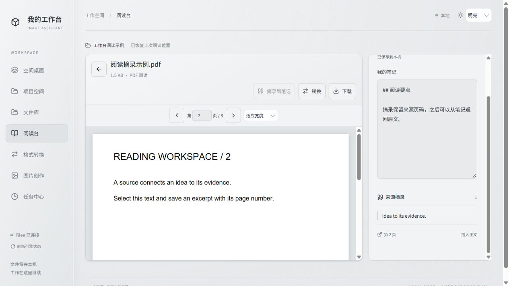

# Image Assistant

一个本地运行的多功能工作台，将项目资料、阅读笔记、文件转换和 AI 图片创作放在同一个空间里。Three.js 桌面提供可旋转、可缩放的入口，日常操作也可以直接使用侧栏。


[快速启动](#快速启动) · [项目与阅读](#项目与阅读) · [配置](#配置) · [数据与备份](#数据与备份) · [详细文档](#详细文档)

## 可以做什么

| 模块 | 当前能力 |
| --- | --- |
| 空间桌面 | 旋转、缩放、点击三维物件进入工具；WebGL 不可用时使用普通导航 |
| 项目空间 | 创建、重命名、导入资料、关联已有文件、记录项目总览笔记 |
| 文件库 | 导入、搜索、批量选择、下载；原文件与转换结果统一管理 |
| 阅读台 | PDF 翻页与缩放、图片查看、文本查找；PDF 和文本选文摘录 |
| 阅读笔记 | 自动保存、来源跳转、Markdown 导出、恢复阅读位置、多窗口版本冲突提示 |
| 格式转换 | 通过本机 Filee CLI 转换，按已安装引擎提供可用目标格式 |
| 任务中心 | 查看排队、处理中、完成与失败状态，打开转换结果 |
| 图片创作 | 单图生成与编辑、故事分镜、诗词意境、版本比较、图库和系列路径展映 |

界面提供明亮、深色、暖灰、纸上故事馆四套主题。写实材质用于三维桌面，按钮采用简洁样式；窄屏下阅读与笔记改为上下排列。

## 快速启动

### 环境

- Node.js **22.13+ 的 22.x 版本，或 24+**，以及 npm。该要求来自当前 PDF.js 依赖。
- 支持现代 Web API 的浏览器；三维桌面需要 WebGL。
- **按需配置**：文件转换需要 Filee CLI；AI 创作需要模型服务；诗词项目等数据库能力需要 MySQL。

仅使用项目、文件库、阅读和笔记，不需要配置 API Key、MySQL 或 Filee。

### 安装与运行

在包含 `package.json` 的项目根目录运行。若本机使用外层 `Image-Assisant` 文件夹，应先进入其中的 `Image-Assistant` 子目录。

```powershell
npm ci
npm run dev
```

打开 <http://localhost:5173/#/desk>。开发命令同时启动 Vite 前端（5173）和 Express 本地服务（3001）。文件、笔记和转换功能需要本地服务保持运行。

需要 AI 创作时，再从 `.env.example` 创建 `.env` 并填写配置；已有 `.env` 时不要覆盖。图片创作页的“API 配置”也可保存密钥，其他选项仍在 `.env` 中设置。

## 项目与阅读

1. 在“项目空间”创建项目，例如“课程阅读”或“产品调研”。
2. 关联文件库中的资料，或在项目中导入文件。同一文件可关联多个项目，无需重复上传。
3. 打开 PDF 或文本，在右侧记录笔记；选中文字后点击“摘录到笔记”。
4. 点击摘录来源返回 PDF 页码或文本位置，也可以把摘录插入正文，或导出 Markdown。
5. 从首页最近项目“继续阅读”，恢复上次的 PDF 页码与缩放、文本滚动位置。

笔记按“项目 + 文件”分别保存；从全局文件库打开的笔记独立保存。输入停止后自动同步到本机服务，浏览器草稿用于异常恢复；确认“已保存到本机”后再关闭页面。另一窗口修改同一笔记时，会提示检查并合并版本。



详细操作、Filee 安装和故障边界见 [工作台说明](docs/workbench.md)。

## 图片创作

- **单图**：文本生图、参考图、图片编辑与可选遮罩，支持 1:1、16:9、9:16。
- **故事**：灵感方向、4–12 镜规划、角色与场景参考、四镜试拍、续拍、单镜重拍及版本对比。
- **诗词**：先解读诗意，再规划画面；分析、分镜与项目进度保存到 MySQL。
- **呈现与导出**：成片阅读、系列路径展映、PNG 长图、原图与旁白 ZIP；图片默认完整显示。

操作步骤、主题截图、模型配置排查和历史验证记录见 [图片创作指南](docs/image-creation.md)。

## 配置

所有配置保存在项目根目录 `.env`，不提交到 Git。下表描述本项目的配置用途；模型名称与可用性以所用服务商和账户为准。

| 配置 | 用途 |
| --- | --- |
| `SUDOCODE_API_KEY` | AI 图片与文本服务密钥 |
| `SUDOCODE_BASE_URL` | 上游 API 地址；未设置时使用代码内默认地址 |
| `SUDOCODE_IMAGE_MODEL` | 图片生成与编辑；代码默认 `gpt-image-2.5-sunburst` |
| `SUDOCODE_TEXT_MODEL` | 灵感、故事规划、诗词解读与提示词组合 |
| `SUDOCODE_VISION_MODEL` | 图片风格分析，需支持图片输入 |
| `MYSQL_HOST / PORT / USER / PASSWORD / DATABASE` | 提示词库、系列、诗词项目等数据库能力 |
| `FILEE_CLI_PATH` | 可选 Filee CLI 路径，例如 `C:/tools/Filee/filee-cli.exe` |
| `PORT` | 后端端口，默认 3001；更改后需同步调整前端代理配置 |

Filee 可使用配置路径，也可放入 `.local/tools/filee/`。转换引擎按需安装，项目不会自动安装可选引擎。文件处理在本机执行；AI 创作会按配置向模型服务发送提示词和相关参考图片。

## 数据与备份

这些存储互相独立，备份时需要按实际使用的功能分别处理。

| 内容 | 保存位置 | 备份方式 |
| --- | --- | --- |
| 项目、笔记、阅读位置、文件与转换任务 | `.local/workbench/` | 停止服务后复制整个目录，包含索引与原文件 |
| 待同步笔记草稿、主题偏好 | 当前站点的浏览器 localStorage | 等待笔记保存到本机服务；草稿不能代替完整备份 |
| 故事项目与版本信息 | 当前站点的浏览器 IndexedDB | 使用故事 JSON 导出；当前没有对应的界面导入入口 |
| 诗词项目、系列与图片元数据、数据库提示词 | 配置的 MySQL 数据库 | 备份对应数据库 |
| 生成图片 | 桌面的 `Image-Assisant/YYYY-MM-DD` | 另行备份图片目录，数据库备份不包含图片文件 |

不要让多个后端进程同时写入同一工作台目录。转换任务因重启中断后会标记为失败，原文件保留，可重新执行。

## 当前边界

- 文件导入每批最多 **10 个**，每个 **50 MB**；文本预览最多读取 **1 MB**，完整文件可下载。
- 笔记正文最多 **10 万字符**、**200 条摘录**；单条摘录最多 **1 万字符**，更长选区只保留前 1 万字符。
- 扫描 PDF 暂无 OCR；加密 PDF 提示下载原件。文本来源查找遇到重复句子时定位首个匹配。
- 尚无项目删除、解除文件关联和摘录删除入口。
- Office 文件需先转换为可阅读格式；暂不提供 Word、Excel、PPT 在线编辑、全文知识库或多人同步。
- 格式转换依赖本机引擎，复杂文档不保证无损。故事与图片生成效果需要用户检查；路径展映尚无 MP4 或配乐导出。

## 开发与验证

技术栈：React 18、TypeScript、Vite、Three.js、PDF.js、Express；可选 MySQL 与 Filee CLI。

| 命令 | 作用 |
| --- | --- |
| `npm run dev` | 同时启动前端和本地服务 |
| `npm run dev:client` | 仅启动前端，不能单独使用文件与笔记接口 |
| `npm run dev:server` | 启动并监听本地服务代码变化 |
| `npm run build` | TypeScript 检查及前端生产构建 |
| `npm start` | 启动本地 API 服务；不托管 `dist` 前端产物 |
| `npm test` | 运行完整现有自动测试 |
| `node --test server/workbench/projects.test.mjs server/workbench/store.test.mjs` | 工作台存储与项目笔记的定向检查 |

项目阅读版本已验证旧索引兼容、保存冲突、重启恢复与写入失败回滚；浏览器检查了摘录、来源跳转、刷新恢复和 390px 窄屏布局。范围与截图见 [验证记录](docs/reviews/2026-10-28-project-reading/README.md)。这些检查不包含真实模型调用或所有转换格式。

## 详细文档

- [工作台、Filee 与阅读笔记](docs/workbench.md)
- [图片创作指南](docs/image-creation.md)
- [产品范围](PRODUCT.md) · [设计规范](DESIGN.md)
- [Impeccable 界面设计工具](docs/impeccable.md)
- [项目阅读实现计划](docs/superpowers/plans/2026-10-28-project-reading.md)

PDF.js 与适配文本层样式的 Apache-2.0 许可见 [许可副本](docs/third-party/pdfjs-LICENSE)。字体许可位于 [public/font-licenses](public/font-licenses/)。Filee 二进制不随仓库提交，安装时应保留其发行包中的许可文件。
