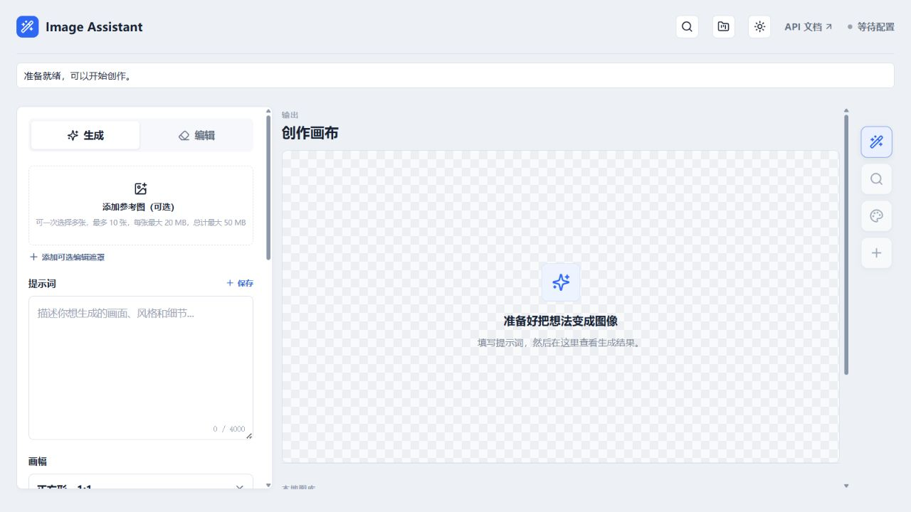
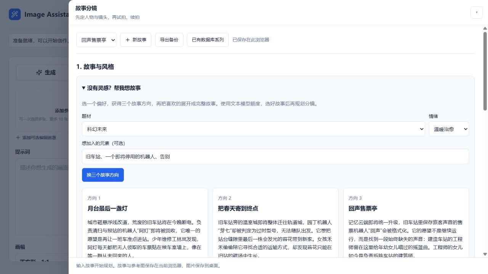
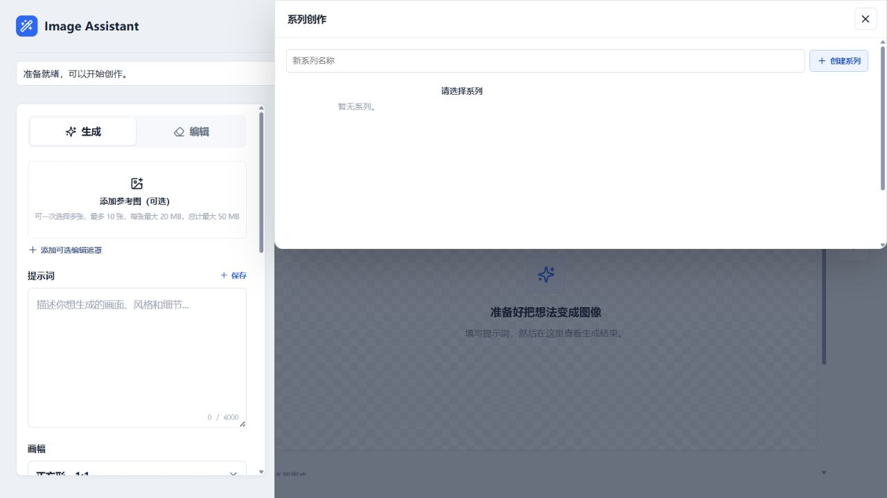

# Image Assistant

本地运行的 AI 图片创作工作台，支持文本生图、参考图创作、图片编辑和结构化提示词。



## 当前能力

- 文本生成图片、参考图生成、图片编辑和可选遮罩
- 默认使用 GPT Image 2.5 Sunburst，支持通过环境变量切换图片模型
- 故事灵感：题材、情绪与关键词生成三个方向，选中后展开为可编辑故事
- 故事分镜：人物与场景参考、4–12 镜规划、四镜试拍、续拍、单镜重拍及浏览器自动保存
- 1:1、16:9、9:16 三种画幅
- 生成结果自动保存到桌面 `Image-Assisant\YYYY-MM-DD`
- 图片合集按系列、节点分层展示，支持预览、下载和继续编辑
- 图片合集系列默认收起，可按系列和节点展开查看
- 诗词意境工作台：先完成译文、注释、背景、结构、表现手法和逐句解读，再拆成画面提示词
- 诗词项目持久化：原文、完整意境分析、分镜、角色设定、连续性规则、补充提示词和画幅保存到 MySQL，刷新后可继续编辑
- 连续分镜角色锁：后续画面自动继承人物外貌、服装、发型、道具、时代、画风和前序提示词
- 图片生成状态与失败重试：显示分析、分镜、出图阶段；临时错误自动重试，失败分镜可单独重新生成
- 右侧扩展栏集中放置风格提取、提示词库、系列创作、诗词意境和 API 配置
- 图片预览支持放大、缩小、重置、`Ctrl + 鼠标滚轮`缩放，以及按住鼠标左键拖动查看放大区域
- 从图片提取风格：分析构图、镜头、光影、色彩、材质和视觉风格
- 结构化提示词优化，可替换主体后再手动生成
- 本地风格模板，适合连续制作同一风格的图片
- 明亮、深色、暖灰三套主题

### 系列创作

点击右侧“系列创作”进入故事分镜工作台：

没有现成故事时，展开“没有灵感？帮我想故事”，选择题材、情绪和可选关键词，点击“给我三个故事方向”。每张卡片包含梗概、转折、关键画面和可展开查看的结尾；不满意可以换一组。选中方向后展开为完整故事，正文可直接修改。点击“采用这个故事”后再规划分镜；当前已有故事时会创建新故事，保留原正文和分镜。灵感偏好、卡片和草稿会随项目自动保存。灵感与展开只调用已配置的文本模型，不自动生成图片。



1. 输入故事与风格，自动规划 4–12 镜，也可以指定镜头数。规划会同时给出人物、场景、景别、动作、视线和前后衔接。
2. 检查人物设定，生成或上传角色参考图，点击“选定此图”。场景参考图可选。
3. 点击“四镜试拍”，先检查前四镜的人物、动作与衔接，再点击“继续生成”。续拍会跳过已完成且未修改的镜头，失败会停止当前批次并保留成果。
4. 可逐镜修改和重拍。修改某镜会把该镜及后续画面标记为“需重拍”；重新规划会保留原版本。

批次开始前及每镜完成后会等待故事进度保存；保存失败会停止后续生成并提示导出备份，已生成图片仍在桌面。批量出图时可以选择“当前镜头后暂停”，当前请求完成后停止。

每镜使用对应角色的固定参考图，同场景可附带紧邻上一镜来衔接动作和道具；换场景时不会继续携带上一镜背景。参考图只约束人物身份与空间，当前分镜决定姿势和构图。

故事分镜会明确要求所选画幅；如果上游仍返回其他比例，保存时会完整缩放并留边，避免居中裁切损失人物脸部或关键动作。角色参考图同样保留完整构图。

故事项目、分镜、上传参考图和进度自动保存在当前浏览器的 IndexedDB，不依赖 MySQL。请使用同一浏览器、同一地址和端口继续创作；清除网站数据会丢失这些记录。可导出 JSON 留存故事设定和进度（目前不提供导入按钮）；生成图片仍保存到桌面，导出文件中的图片路径依赖这些本地图片。

原有系列与节点管理从“已有数据库系列”进入，仍使用 MySQL。



### 两种灵感入口

| 入口 | 生成内容 | 后续操作 |
| --- | --- | --- |
| 主页面“生成新灵感” | 6 条独立图片提示词 | 选择提示词后生成单张图片 |
| 系列创作“没有灵感？帮我想故事” | 3 个故事方向及选中方向的完整正文 | 采用故事、规划分镜、定稿角色后试拍 |

两者均需要配置 `SUDOCODE_TEXT_MODEL`，点击时会使用文本模型额度。

### 诗词意境

点击右侧扩展栏的书本图标进入“诗词意境”工作台。工作台会列出数据库中最近编辑的诗词项目，点击项目即可继续上次的原文、分析、分镜和出图进度；“新建”可以开始新的诗词。没有历史项目时才会显示内置的《咸阳城东楼》示例。

诗词画面可以选择 3–8 段。工作台会根据逐句分析得到的意象单元推荐 4、6 或最多 8 段，并说明推荐理由；可以一键采用，也可以手动调整。短诗通常适合按起承转合分为 4 段，需要分别表现景物或情绪转折时可以增加到 6 段。

点击“分析诗词意境”后，文本模型会先生成一份可编辑的完整解读，包括体裁与标签、译文、重点注释、创作背景、历史语境、结构分析、表现手法、视觉/听觉/空间/时间线索、整体赏析、核心意象、情绪变化、逐句理解、典故和存疑点。确认或修改这些内容后，再点击“生成分镜提示词”。分镜阶段会使用完整解读，而不是只根据诗词表面的关键词联想。

旧项目可能只有原文和分镜，没有新版完整解读。打开此类项目时，页面会提示点击“重新分析诗词意境”；重新分析后会补齐上述栏目，不会在刷新页面时自动调用模型消耗额度。

生成分镜时，模型会同时给出统一视觉、角色设定锁和连续性规则。每张图片请求都会包含这些全局设定、整体提示词补充、前序分镜提示词和当前分镜提示词，减少人物在后续画面中更换衣服、发型、年龄、道具或画风的情况。角色设定和连续性规则可以在诗词抽屉中继续修改，并随项目保存。

生成后的提示词可以逐段修改。点击某一段右侧的生成按钮只生成该段，点击“批量生成全部”则按当前顺序生成所有段落；每段都会显示等待、生成中、成功或失败状态，批量生成还会显示当前序号和进度条。遇到限流、HTTP 524、其他网关错误或服务暂时不可用时会自动重试，仍失败的段落可以点击“重新生成”。结果会回填到主画布并保存到本地图库。图片画幅沿用主工作台当前选择。

诗词图片会自动附加曝光和画质约束：主体细节保持清晰、阴影不死黑、低噪点，并将胶片颗粒控制在轻微范围。若整体提示词中主动加入“暗黑、低照度、重胶片颗粒”等描述，模型仍可能生成更暗或更粗粝的画面。

中转站偶尔会返回与请求参数不同的原始图片尺寸。程序保存前会按所选画幅统一裁切并输出固定尺寸，确保图库文件和页面预览不会出现同组选项却比例不一致的情况。

## 快速启动

```powershell
Copy-Item .env.example .env
# 编辑 .env，填入 SUDOCODE_API_KEY
npm ci
npm run dev
```

打开 <http://localhost:5173>。

开发模式会启动：

- 前端：`http://localhost:5173`
- 本地 API 代理：`http://localhost:3001`

首次打开时，可以点击右侧扩展栏的钥匙图标进入“API 配置”，粘贴 API Key 后保存。密钥只写入项目根目录的 `.env` 文件，并且只允许本机请求；服务端不会把密钥返回给浏览器。已有 `.env` 时不要重复复制覆盖；故事与灵感功能还需手动配置 `SUDOCODE_TEXT_MODEL`。

## 配置

`.env` 不会提交到 Git。最小配置：

```ini
SUDOCODE_API_KEY=你的密钥
```

也可以直接复制 `.env.example` 为 `.env` 后手动编辑。页面里的 API 配置只会更新 `SUDOCODE_API_KEY`，其他选项仍需在 `.env` 中配置。

可选配置：

```ini
SUDOCODE_BASE_URL=https://api.sudocode.chat/v1
SUDOCODE_IMAGE_MODEL=gpt-image-2.5-sunburst
SUDOCODE_TEXT_MODEL=gpt-6-sol
SUDOCODE_VISION_MODEL=gpt-5.4-mini
```

其中：

- `IMAGE_MODEL` 用于所有图片生成和编辑，包括参考图、系列分镜与诗词图片；默认 `gpt-image-2.5-sunburst`，侧重画质和精确编辑。可设为 `gpt-image-2.5-flare` 侧重速度，或 `gpt-image-2` 回退到旧模型。切换前需确认当前供应商和账户支持该模型，修改后重启后端并刷新页面。
- `TEXT_MODEL` 用于生成灵感、故事分镜、诗词完整解读和提示词组合；需配置供应商实际支持的文本模型，`gpt-6-sol` 已用于本次故事规划实测。
- `VISION_MODEL` 用于从图片提取风格
- 诗词意境工作台使用 `TEXT_MODEL` 解析诗句并生成分段画面提示词
- `MYSQL_*` 用于启用提示词库、系列、节点和图片元数据持久化

GPT Image 2.5 沿用 Images API 的生成和编辑接口，当前三种画幅继续适用。页面底部和生成进度会显示服务端当前采用的模型；新图片元数据记录实际请求的模型名，已有图片记录保持原样。项目保留默认画质设置，不主动启用 `xhigh` 或 `max`。模型说明见 [OpenAI 图像生成文档](https://developers.openai.com/api/docs/guides/image-generation)，中转站的实际计费以供应商为准。

诗词项目会额外写入 `poetry_projects` 表，并通过 `series_id` 关联图片合集；修改项目时更新同一条记录，不会因为刷新或继续编辑重复创建项目。应用启动迁移时，会把旧的“诗词意境创作合集”自动补成可继续编辑的诗词项目，并自动添加角色设定和连续性字段，不会删除已有数据。

`SUDOCODE_VISION_MODEL` 必须填写支持图片输入的模型，否则“从图片提取风格”会提示“未配置 SUDOCODE_VISION_MODEL”。示例中的 `gpt-5.4-mini` 已在当前 SudoCode 模型列表验证可用；如果你的账户模型列表不同，请替换为账户中实际可用的视觉模型。

### 诗词接口排查

- HTTP 524 表示上游网关等待文本模型超时，不代表本地数据库或诗词项目损坏。程序会对 524、429 和常见 5xx 错误自动重试最多 3 次。
- 如果某个文本模型持续超时，请通过当前 API 供应商的模型列表确认模型名称和账户权限，并将 `SUDOCODE_TEXT_MODEL` 换成实际可用、响应较快的文本模型；修改 `.env` 后需要重启后端。
- 文本模型偶尔可能少返回一个扩展栏目。程序会保留可用的核心分析并将缺失栏目留空，不会因为单个非核心字段缺失而丢弃整次结果。
- 页面错误中的“请求 ID”可以用于查询本地服务日志和上游请求记录。

### 灵感与故事排查

- “未配置 SUDOCODE_TEXT_MODEL”：在 `.env` 中填写账户可用的文本模型，并重启后端。图片模型与文本模型分别配置。
- 主页面“生成新灵感”曾出现 `One of "input" or "previous_response_id" or 'prompt' or 'conversation' must be provided`：旧实现只发送系统消息，某些中转服务转换请求后缺少任务输入。当前实现已增加用户任务消息并修正 JSON 示例；更新代码后重启开发服务。
- 修改后页面仍调用旧接口或返回 404：停止原来的 `npm run dev`，再重新启动。部分 Windows 环境中，自动重启可能未替换旧后端进程。
- “需重拍”表示分镜、参考图或画幅发生变化；续拍会重新生成这些镜头。仅缺少图片文件时，请重新上传参考图或重拍对应镜头。
- 故事工作台显示“保存失败”时，先导出备份再处理浏览器存储；程序会停止后续批量出图，已保存到桌面的图片仍然存在。

## 数据库说明

当前没有 MySQL 也可以使用图片生成、编辑、风格提取、本地风格模板和新版故事分镜（保存在当前浏览器）。提示词库、旧系列管理、诗词历史项目和图片数据库合集会保留为空，连接 MySQL 后即可启用数据库持久化能力。未连接数据库时，诗词项目只在当前页面会话中存在，刷新后不会保留。

图片文件始终保存到桌面目录，数据库只保存元数据。

如果本机已安装 MySQL，可在 `.env` 中取消注释并填写 `MYSQL_HOST`、`MYSQL_PORT`、`MYSQL_USER`、`MYSQL_PASSWORD` 和 `MYSQL_DATABASE`。应用启动时会尝试连接数据库；连接失败不会阻止不依赖数据库的图片生成和编辑功能。

## 常用命令

```powershell
npm run dev       # 前端 + 本地代理
npm run build     # 生产构建
npm test          # 全量测试
```

## 本次改动与代码位置（2026-10）

| 改动 | 主要代码 |
| --- | --- |
| 图片模型可配置，默认 Sunburst；状态、请求和新图片元数据使用实际模型名 | `.env.example`、`server/index.mjs`、`src/App.tsx` |
| 故事灵感生成三个方向、展开正文、校验文本结果 | `server/story-inspiration.mjs`、`src/StoryInspiration.tsx` |
| 按故事时代与类型规划人物、场景、动作、视线和衔接，兼容旧系列接口 | `server/storyboard-generator.mjs` |
| 定稿参考图、四镜试拍、续拍、暂停、单镜重拍、保留旧版本 | `src/StoryWorkbench.tsx`、`src/story-workbench.css` |
| 选择当前角色和场景参考，同场景关联紧邻上一镜；区分人物身份与镜头构图 | `src/storyboard-continuity.mjs`、`src/storyboard-continuity.d.mts` |
| 故事、灵感草稿和上传参考图保存在 IndexedDB，顺序保存并报告失败 | `src/story-project-store.ts` |
| 故事图片及参考图比例不符时完整缩放留边，避免强制裁切头部 | `server/generated-image-store.mjs` |
| 主页面“生成新灵感”补充用户任务消息，修复部分中转服务缺少输入的错误 | `server/prompt-generator.mjs` |

新增文本接口为 `POST /api/storyboard/ideas`、`POST /api/storyboard/expand`、`POST /api/storyboard/plan`，分别返回 `{ ideas }`、`{ draft }`、`{ plan }`。它们复用服务端密钥和文本模型，不依赖 MySQL。图片仍通过已有的生成与编辑接口输出。

### 验证范围

自动测试覆盖图片模型默认值与切换、文本请求输入、故事结构校验、参考选择、试拍与续拍筛选、图片尺寸与构图保留。2026-10-09 提交前验证：`npm test` 共 104 项通过，`npm run build` 与 `git diff --check` 通过。

已实测：Sunburst 生图与编辑；《雨天出门》六镜规划及前四镜试拍；修复裁切后重拍第一镜；三个故事方向生成、《回声售票亭》展开与采用；刷新恢复故事及草稿；主页面成功生成六条新灵感。未完成修复后整组六镜的重新出图，也未验证多人长故事的整体视觉效果。

当前限制：故事保存属于当前浏览器和站点地址，不支持跨设备同步；JSON 导出尚无界面导入；人物与场景一致性仍需通过试拍检查，不能保证每次生成完全一致。

## 说明

“从图片提取风格”用于学习图片的视觉表达并替换成自己的内容，不是去水印功能，也不会直接修改原图。应用只通过本地代理访问上游 API，API Key 不会发送到浏览器端。
